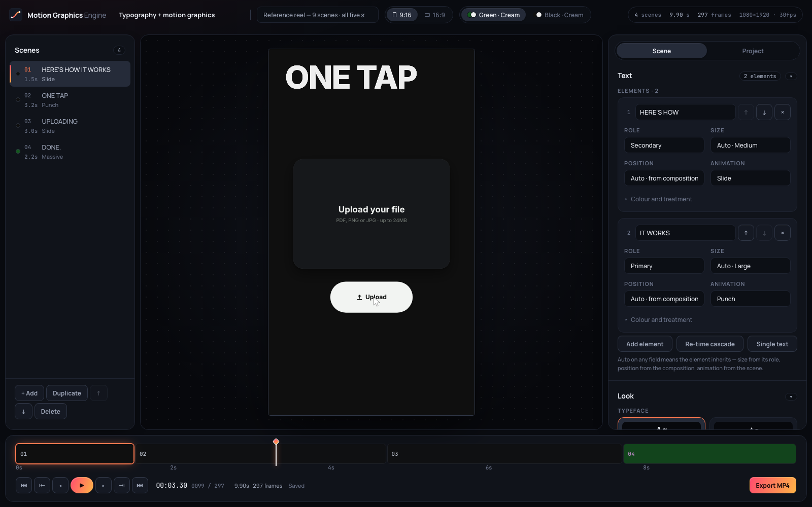
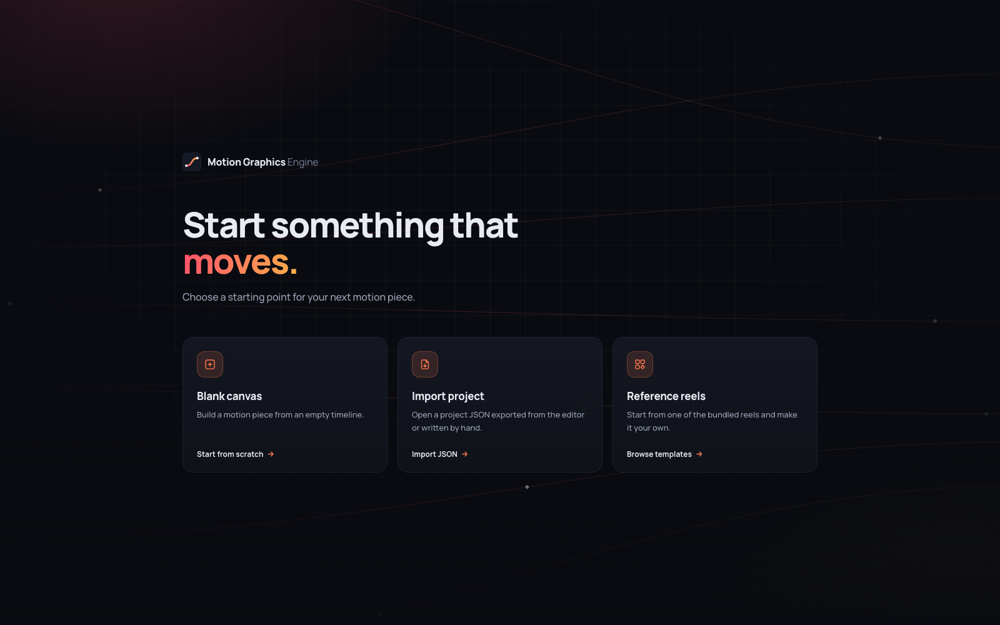
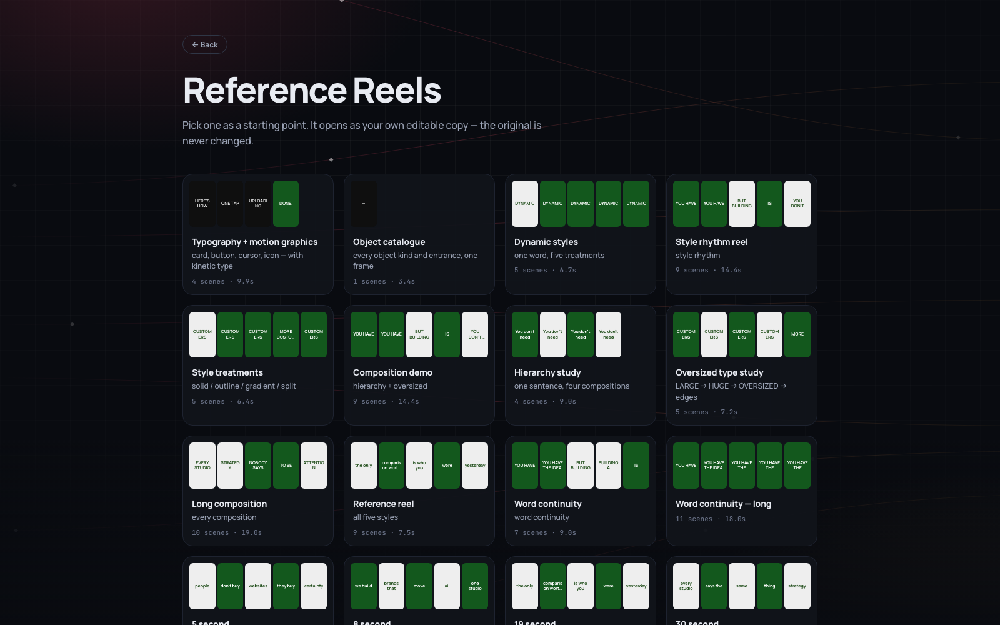

# Motion Graphics Engine

A scene-based kinetic typography and motion graphics editor. Write text, break it into scenes, choose how each scene moves and looks, add graphics and a soundtrack, and render a 1080×1920 or 1920×1080 H.264 video. Built on React and [Remotion](https://www.remotion.dev).



## Features

- **Scene editor** with live preview, a scrubbable timeline and frame-accurate transport controls
- **Five kinetic styles** (Massive, Punch, Stack, Slide, Rapid) plus a static hold, each with its own measured easing, motion blur and word-to-word transitions
- **Composed scenes**: independent text elements with roles, semantic sizes, positions and per-element animation, draggable on the canvas
- **Visual treatments**: solid, outline, gradient and split type, per-word colour, and custom project palettes
- **Motion graphics objects**: cards, buttons, shapes, icons, images, logos, groups and an animated cursor that can drive button states
- **Audio**: one project-level track with trimming, offset, volume and fades, previewed on the same clock as the video
- **Portrait and landscape** output, re-planned for each frame shape rather than cropped
- **Projects as JSON**: extract any reel to a document and import it back unchanged; the same format is used everywhere
- **Reference reels** to start from, a phrase builder that turns a sentence into a paced run of scenes, and local auto-save
- **Render server** for MP4 export, single-frame stills and contact sheets, with a job queue, uploads, retention, rate limiting and an optional access token
- **MCP server** exposing 68 tools so an AI client can build, inspect, time and render projects ([docs/MCP.md](docs/MCP.md))

| Start | Templates |
| --- | --- |
|  |  |

## How it works

```
project JSON ──► importer ──► Scene[] ──► planner ──► Remotion composition ──► MP4
                   ▲                         │
   editor ─────────┘                         └── measured layout, timing and motion per frame
```

Layout lives in the planner (`src/utils/plan.ts`); motion lives in the style components (`src/components/motion`). A style receives a fully measured plan and only decides how things move, so adding one is a component plus a registry entry.

The editor preview and the exported video run the same composition (`src/compositions/MotionVideo.tsx`). Exports are rendered by `server/render-server.mjs` through `@remotion/renderer`, so the MP4 matches what you see in the preview.

## Getting started

Requires Node.js 20.19+ (22 LTS recommended).

```bash
npm install
npm run dev
```

- `http://localhost:5310`: editor
- `http://localhost:5311`: render server, started by the same command

The first export downloads a headless Chrome build and bundles the composition; later exports reuse both. Ports are fixed and fail loudly if taken. Move them with `MGE_APP_PORT` and `MGE_RENDER_PORT`.

## Scripts

| Command | What it does |
| --- | --- |
| `npm run dev` | Editor and render server together |
| `npm run build` | Production build of the editor into `dist/` |
| `npm start` | Render server only; also serves `dist/` when it exists |
| `npm run render -- scenes.json` | Render a scene list from the command line |
| `npm run studio` | Open the composition in Remotion Studio |
| `npm run mcp` | Start the MCP server on stdio |
| `npm test` | Engine, server, MCP and render tests |
| `npm run check` | Typecheck, engine baseline and the full test suite |
| `npm run baseline:write` | Re-record the engine baseline after an intended change |
| `node scripts/brand.mjs` | Regenerate the favicons and logo raster from `public/brand/mark.svg` |

## Project format

A project is a JSON document of scenes. The minimum is a list of scenes with text, duration, animation and background:

```json
{
  "title": "Launch teaser",
  "scenes": [
    { "text": "you have", "duration": 1.0, "animation": "SLIDE", "direction": "BOTTOM", "background": "GREEN" },
    { "text": "the idea.", "duration": 1.4, "animation": "PUNCH", "emphasis": ["idea."], "background": "CREAM" },
    { "text": "ship it", "duration": 1.6, "animation": "MASSIVE", "background": "GREEN" }
  ]
}
```

Validation is all or nothing: every problem is reported at once and a document with any error changes nothing. **Extract JSON** in the editor emits the same shape that **Import JSON** reads.

- [`templates/SCHEMA.md`](templates/SCHEMA.md): full field reference, including compositions, styles, objects and audio, with prompt blocks for generating scripts
- [`templates/script-template.json`](templates/script-template.json): a working five-scene starting point
- [`templates/script-full-reference.json`](templates/script-full-reference.json): every field the importer reads

## Render API

| Route | Purpose |
| --- | --- |
| `POST /api/render` | Queue an MP4 render; returns a `jobId` |
| `GET /api/render/:id` | Job status and progress |
| `DELETE /api/render/:id` | Cancel a job |
| `POST /api/still` | Render a single frame to PNG |
| `POST /api/contact-sheet` | Render selected frames tiled into one image |
| `POST /api/upload?kind=image\|audio` | Upload a raw image or audio body; returns its `uploads/` path |
| `GET /out/:file` | Rendered outputs |
| `GET /uploads/:file` | Uploaded assets |
| `GET /api/health` | Queue, disk, memory and bundle state |

## Configuration

Every setting is optional. An unset environment behaves like local development.

| Variable | Default | Purpose |
| --- | --- | --- |
| `MGE_APP_PORT` | `5310` | Vite dev server port |
| `MGE_RENDER_PORT` | `5311` | Render server port |
| `MGE_HOST` | `0.0.0.0` | Render server bind address |
| `MGE_DATA_DIR` | `.mge-data` | Uploads, job state and the Remotion public directory |
| `MGE_OUT_DIR` | `out` | Rendered files |
| `MGE_UPLOAD_DIR` | `$MGE_DATA_DIR/uploads` | Uploaded media |
| `MGE_DIST_DIR` | `dist` | Editor build served by the render server |
| `MGE_MAX_CONCURRENT_RENDERS` | `1` | Renders that run at once; the rest queue |
| `MGE_MAX_TOTAL_FRAMES` | `3600` | Frame ceiling per render |
| `MGE_MAX_SCENES` | `100` | Scene ceiling per render |
| `MGE_MAX_SCENE_SECONDS` | `12` | Longest allowed scene |
| `MGE_MAX_JSON_MB` / `MGE_MAX_UPLOAD_MB` / `MGE_MAX_AUDIO_MB` | `8` / `24` / `64` | Request size limits |
| `MGE_RETENTION_HOURS` | `0` (off) | Delete outputs older than this |
| `MGE_MAX_DISK_GB` | `0` (off) | Refuse new work above this disk usage |
| `MGE_SWEEP_MINUTES` | `30` | Retention sweep interval |
| `MGE_ACCESS_TOKEN` | unset | Require a token (bearer header or sign-in page) |
| `MGE_SESSION_HOURS` | `720` | Browser session length when a token is set |
| `MGE_RATE_LIMIT_RENDERS` / `MGE_RATE_LIMIT_UPLOADS` | `60` / `120` | Requests per window per client |
| `MGE_RATE_WINDOW_MINUTES` | `1` | Rate limit window |
| `MGE_TRUST_PROXY` | off | Trust `X-Forwarded-For`; enable behind a reverse proxy |

## Deployment

The editor is a static Vite build, and `netlify.toml` deploys it on its own. Export and uploads need the render server, which needs a long-running Node host with enough memory for headless Chrome.

To run everything from one process:

```bash
npm run build
MGE_ACCESS_TOKEN=change-me MGE_RETENTION_HOURS=72 MGE_TRUST_PROXY=1 npm start
```

The render server then serves the editor, the API, outputs and uploads on one port. Put it behind a TLS-terminating proxy and point `MGE_DATA_DIR` and `MGE_OUT_DIR` at persistent storage.

## Testing

```bash
npm run check
```

Covers the importer and serialiser, persistence, the render server (auth, limits, queue, uploads, restarts), the MCP tools, and render tests that compare real frames. Render suites skip themselves when the render server is not running; start it with `npm run dev:render` to include them.

## Project structure

```
src/
  compositions/        MotionVideo and the per-scene renderer
  components/motion/   kinetic styles, objects, overlay and audio layers
  components/editor/   editor panels, canvas stages, timeline and export
  components/start/    splash, start screen and template browser
  data/                reference reels, object presets and the phrase builder
  utils/               planner, importer, typography, timing, easing, persistence
server/                render server, job queue, auth, limits and static serving
mcp/                   MCP server, tools and tests
templates/             schema reference and example projects
scripts/               baseline snapshot, brand assets and the render CLI
test/                  engine, server and render tests
```

## Notes

Remotion is free for individuals and small teams; larger companies need a company licence. See [remotion.dev/license](https://www.remotion.dev/license).
